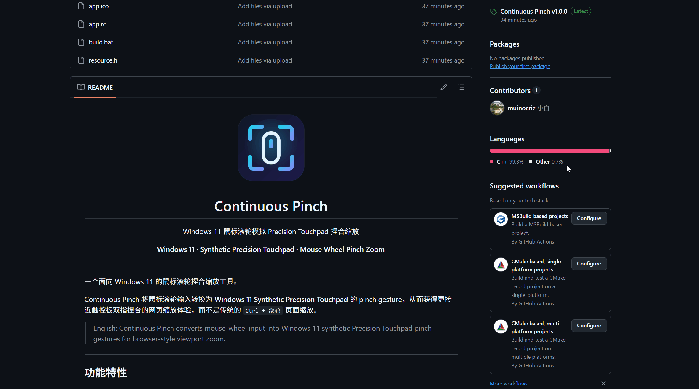
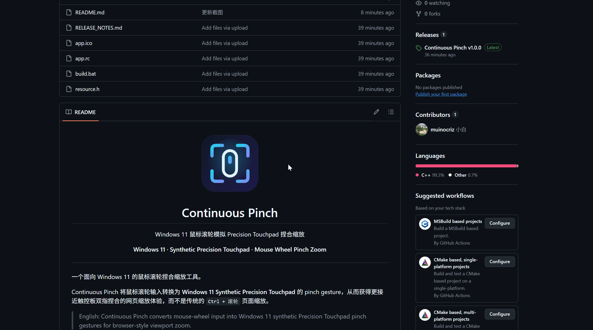

<p align="center">
  
</p>

<h1 align="center">Continuous Pinch</h1>

<p align="center">
  Windows 11 鼠标滚轮模拟 Precision Touchpad 捏合缩放
</p>

<p align="center">
  <strong>Windows 11 · Synthetic Precision Touchpad · Mouse Wheel Pinch Zoom</strong>
</p>

<p align="center">
  
  
  
</p>

---

Continuous Pinch 是一个面向 Windows 11 的鼠标滚轮捏合缩放工具。

它将鼠标滚轮输入转换为 **Windows 11 Synthetic Precision Touchpad** 的 pinch gesture，让 Chrome / Edge 获得更接近真实触控板双指捏合的 viewport 缩放体验，而不是传统 `Ctrl + 滚轮` 的页面缩放。

> English: Continuous Pinch converts mouse-wheel input into Windows 11 synthetic Precision Touchpad pinch gestures for browser-style viewport zoom.

---

## 功能特性

- 使用 Windows 11 Synthetic Precision Touchpad (`PT_TOUCHPAD`) 注入真正的触控板捏合手势
- `Alt + 滚轮` 执行触控板式捏合缩放
- **默认按鼠标悬停窗口判定目标，无需先点击浏览器获取焦点**；可切换为“当前前台窗口”模式
- 应用白名单，默认支持 Chrome / Edge
- 缩小时不会低于工具维护的逻辑 100% 基准，**每个浏览器窗口单独记录**
- `Alt + 中键` 平滑回到逻辑 100% 基准；`Ctrl + Alt + 中键` 硬复位虚拟触控板
- 支持慢速逐格滚轮，按住缩放修饰键时保持同一个手势
- Direct / Linear / Exponential / Adaptive 多种平滑曲线，灵敏度实时调节
- 修饰键与退出热键可配置
- 松开 Alt 后不会激活浏览器菜单
- 独立输入线程，只在缩放时运行帧定时器，空闲时几乎不占 CPU
- 中文 / English 界面，设置窗口支持高 DPI 与键盘操作
- 系统托盘、开机启动、单实例运行
- INI 配置（UTF-16），EXE 目录不可写时自动改存到 `%APPDATA%`

---

## 动图演示

### 1. 缩放功能演示

鼠标移动到白名单中的浏览器窗口上，按住 `Alt` 并滚动滚轮即可缩放。默认悬停模式下，浏览器不需要提前获得焦点。

<p align="center">
  
</p>

### 2. 中键复位功能演示

按住 `Alt` 并点击鼠标中键，可平滑回到工具记录的逻辑 100% 基准。

<p align="center">
  
</p>

---

## 软件截图

### 中文界面


### English UI


### 系统托盘


---

## 下载与运行

1. 从 [Releases](https://github.com/muinocriz/continuous-pinch/releases) 页面下载 `ContinuousPinch.exe`，或参照下文“编译”自行编译。
2. 直接运行即可，无需安装。首次运行会自动打开设置窗口。
3. 程序常驻系统托盘；再次运行 EXE 会打开已运行实例的设置窗口，而不会启动第二个实例。

> 如果浏览器以管理员身份运行，Windows 会阻止普通权限程序向其注入输入，此时本程序也需要以管理员身份运行。

---

## 默认操作

| 功能 | 默认操作 |
|---|---|
| 放大 | `Alt + 滚轮向上` |
| 缩小 | `Alt + 滚轮向下` |
| 回到逻辑 100% 基准（作用于被点击的窗口） | `Alt + 中键` |
| 硬复位虚拟触控板（清空所有窗口的基准） | `Ctrl + Alt + 中键` |
| 退出 | `Ctrl + Alt + Shift + F12` |

修饰键和退出热键都可以在设置窗口中修改。软复位和硬复位都使用鼠标中键，因此两者的修饰键不能相同。

---

## 设置窗口

双击托盘图标，或在托盘菜单中选择“设置...”打开。设置分为四组：

| 分组 | 内容 |
|---|---|
| 常规 | 启用 / 禁用、界面语言、开机启动 |
| 缩放 | 灵敏度（每格滚轮的缩放比例）、平滑曲线、目标窗口判定模式 |
| 按键 | 缩放、软复位、硬复位的修饰键，退出热键 |
| 应用白名单 | 每行一个进程名 |

- 拖动灵敏度滑块、切换平滑曲线或语言会立即生效，方便边调边试；其余设置在点“确定”或“应用”后生效。
- “取消”、`Esc` 或右上角关闭按钮会放弃所有未应用的修改。
- “恢复默认”只填充默认值，点“确定”或“应用”后才会生效；它不会改变开机启动设置。
- 支持 `Tab` 切换控件、`Enter` 确定、`Esc` 取消。
- 窗口底部显示当前配置文件的路径，点“打开位置”可在资源管理器中定位。
- 如果开机启动项指向另一个位置的程序（例如移动过 EXE），设置窗口会给出提示，勾选后改为指向当前程序。

---

## 目标判定模式

Continuous Pinch 提供两种目标应用判定方式。

### 鼠标悬停窗口（默认，推荐）

默认模式下，程序根据**鼠标指针所在窗口**判断目标应用：

```text
鼠标位置
→ WindowFromPoint
→ GetAncestor(GA_ROOT)
→ 获取所属进程
→ 应用白名单
→ Synthetic Precision Touchpad pinch
```

因此即使其它程序当前拥有键盘焦点，只要鼠标移动到 Chrome / Edge 上，就可以直接使用：

```text
Alt + 滚轮
```

无需先点击浏览器。

### 当前前台窗口

如果切换为“当前前台窗口”，程序会使用当前获得焦点的顶层窗口进行白名单判断，行为与早期版本一致。

配置文件对应：

```ini
[Applications]
TargetMode=0
```

其中：

```text
0 = 鼠标悬停窗口
1 = 当前前台窗口
```

---

## 应用白名单

默认白名单：

```text
chrome.exe
msedge.exe
```

可以在设置窗口中修改，例如：

```text
chrome.exe
msedge.exe
brave.exe
```

只有白名单中的应用才会响应 Continuous Pinch。

在默认“鼠标悬停窗口”模式下，判断的是鼠标所在窗口所属的应用；在“当前前台窗口”模式下，判断的是当前前台应用。

---

## 100% 基准说明

Continuous Pinch 无法读取页面实际的捏合缩放比例，因此维护自己的逻辑缩放基准。每个窗口第一次缩放时：

```text
logicalScale = 1.0
```

工具允许：

```text
100% → 放大 → 缩小 → 回到 100%
```

但不会继续缩小到工具记录的 100% 以下。

**每个浏览器窗口单独记录自己的基准。** 例如把窗口 A 放大到 200% 后，再到窗口 B（仍是 100%）上缩小，不会有任何作用，也不会影响 A；回到 A 后仍可从 200% 正常缩小。关闭的窗口会被自动忘记，新窗口从 100% 开始。

> 同一窗口内的多个标签页共用一个基准：工具无法感知标签页切换。浏览器在页面跳转后也会自行把页面缩放重置为 100%，此时可用软复位让工具的基准与页面重新对齐。

如果程序运行期间使用真实触控板、浏览器其它手势或其它方式修改页面视觉缩放，Continuous Pinch 无法直接读取 Chromium 当前的 visual viewport scale，因此内部基准可能与页面实际状态产生偏差。

可以使用：

```text
Alt + 中键
```

执行软复位，或使用：

```text
Ctrl + Alt + 中键
```

执行硬复位。

---

## 慢速滚轮支持

只要缩放修饰键仍然按住，Continuous Pinch 会维持同一个触控板手势（两个虚拟触点保持按下）。

例如：

```text
按住 Alt
→ 滚一格
→ 等 1 秒
→ 再滚一格
→ 等 1 秒
→ 再滚一格
```

不会因为滚轮事件间隔较长而立即结束 pinch。

---

## 平滑曲线

| 曲线 | 特点 |
|---|---|
| 直接 / 即时（Direct） | 每格滚轮立即跳到目标，响应最直接 |
| 线性（Linear） | 以固定速度移动到目标 |
| 指数（Exponential） | 先快后慢地逼近目标 |
| 自适应（Adaptive，默认推荐） | 离目标越远移动越快，兼顾跟手与平滑 |

如果希望响应更直接，可以尝试“直接”或调高灵敏度。

---

## 系统要求

- Windows 11（Synthetic Precision Touchpad 是 Windows 11 的功能）
- 支持 Precision Touchpad 捏合手势的目标应用
- 自行编译时：Visual Studio 2022（MSVC）与 Windows SDK

主要测试目标：

- Microsoft Edge
- Google Chrome

---

## 项目结构

```text
continuous-pinch/
├─ src/
│  ├─ Main.cpp               # 入口、主窗口消息、托盘命令
│  ├─ Common.h               # 公共头文件、常量、配置类型
│  ├─ Config.h/.cpp          # 配置状态、INI 位置与读写、开机启动、本地化
│  ├─ InputThread.h/.cpp     # 输入线程：消息循环、按需高精度帧定时器、配置快照
│  ├─ Pinch.h/.cpp           # 捏合手势状态机：滚轮、平滑、分段、复位
│  ├─ Touchpad.h/.cpp        # Windows 11 Synthetic Precision Touchpad 设备与帧注入
│  ├─ Target.h/.cpp          # 目标应用（白名单）判定与缓存
│  ├─ MouseHook.h/.cpp       # WH_MOUSE_LL 低级鼠标钩子（运行在输入线程）
│  ├─ Tray.h/.cpp            # 托盘图标与菜单
│  ├─ SettingsWindow.h/.cpp  # 设置对话框（模板在 app.rc）、退出热键
│  ├─ Util.h/.cpp            # 时间、字符串、路径工具
│  └─ App.h                  # 全局窗口句柄
├─ assets/
│  ├─ app-logo.png
│  ├─ gifs/
│  │  ├─ zoom-demo.gif
│  │  └─ reset-demo.gif
│  └─ screenshots/
│     ├─ settings-cn.png
│     ├─ settings-en.png
│     └─ tray-menu.png
├─ app.ico
├─ app.rc                   # 图标、manifest、设置对话框模板
├─ app.manifest             # Common Controls v6、Per-Monitor V2 DPI
├─ resource.h               # 资源与控件 ID
├─ build.bat
├─ README.md
├─ CHANGELOG.md
├─ RELEASE_NOTES.md
├─ .clang-format
├─ .gitattributes
└─ .gitignore
```

---

## 编译

推荐打开：

```text
x64 Native Tools Command Prompt for VS 2022
```

进入项目目录后：

```bat
build.bat
```

`build.bat` 会先编译 Windows 资源（图标、manifest、设置对话框），再编译 `src` 下的全部源文件（中间文件输出到 `build\`）：

```bat
rc /nologo /fo build\app.res app.rc

cl /nologo /std:c++17 /EHsc /O2 /utf-8 /W4 ^
   /DUNICODE /D_UNICODE ^
   /Fobuild\ ^
   src\*.cpp ^
   build\app.res ^
   user32.lib comctl32.lib winmm.lib shell32.lib advapi32.lib gdi32.lib ^
   /Fe:ContinuousPinch.exe ^
   /link /SUBSYSTEM:WINDOWS /MANIFEST:NO
```

`app.manifest` 由 `app.rc` 嵌入 EXE，因此链接时使用 `/MANIFEST:NO`，避免生成第二份 manifest。

在 CI 等非交互环境中可以使用 `build.bat nopause` 跳过结尾的暂停。

代码格式由仓库根目录的 `.clang-format` 定义，修改代码后可执行：

```bat
clang-format -i src\*.cpp src\*.h
```

如果出现：

```text
LINK : fatal error LNK1104: 无法打开文件“ContinuousPinch.exe”
```

通常表示旧版 `ContinuousPinch.exe` 仍在运行。先从托盘退出程序或结束对应进程，再重新编译。

---

## 配置文件

配置保存在 `continuous_pinch_v3.ini` 中，位置按以下顺序确定：

1. EXE 同目录下已有配置文件 → 使用它（便携方式，也兼容 v1.0.x）
2. `%APPDATA%\ContinuousPinch\` 下已有配置文件 → 使用它
3. EXE 所在目录可写 → 保存在 EXE 同目录
4. 否则（例如 EXE 放在 `Program Files` 中）→ 保存到 `%APPDATA%\ContinuousPinch\`

设置窗口底部会显示当前使用的配置文件路径，点“打开位置”可以在资源管理器中定位到它。

配置文件使用 UTF-16 编码，白名单中可以包含中文等非 ASCII 进程名。v1.0.x 的 ANSI 配置文件会在首次启动时自动转换。

配置内容包括：

- 当前语言
- 是否启用
- 灵敏度
- smoothing 曲线
- 缩放/复位修饰键
- 退出热键
- 应用白名单
- **目标判定模式（悬停 / 前台）**
- 开机启动

> 当前配置文件名保留了开发阶段的历史命名。

---

## 托盘菜单

程序启动后常驻 Windows 系统托盘，可以：

- 启用 / 禁用
- 打开设置
- 回到逻辑 100% 基准（作用于最近操作的窗口）
- 硬复位虚拟触控板
- 设置开机启动
- 退出

资源管理器重启后，托盘图标会自动恢复。

双击托盘图标可以直接打开设置窗口。

---

## 工作原理

传统浏览器页面缩放：

```text
Mouse Wheel
→ Ctrl + Wheel
→ Browser Page Zoom
```

Continuous Pinch：

```text
Mouse Wheel
→ Continuous Pinch
→ Windows Synthetic Precision Touchpad
→ PT_TOUCHPAD
→ Pinch Gesture
→ Browser Viewport Zoom
```

目标是模拟真正的触控板捏合手势，而不是浏览器页面缩放百分比快捷键。

程序内部分为两个线程：

- **界面线程**：托盘、设置窗口、配置读写。
- **输入线程**：低级鼠标钩子、捏合手势状态机、虚拟触控板。钩子只处理滚轮和中键事件，其它鼠标事件立即放行；帧定时器只在缩放进行时以 125 Hz 运行，空闲时线程完全休眠。

两个线程互不阻塞，界面操作不会影响鼠标输入的响应。

---

## 已知限制

- 仅支持 Windows 11。
- 工具维护自己的逻辑 100% 基准，无法直接同步其它设备产生的 viewport pinch scale。
- 逻辑基准按浏览器窗口记录，同一窗口内的不同标签页共用一个基准。
- 浏览器在页面跳转后会把捏合缩放重置为 100%，工具无法感知，可用软复位重新对齐。
- 普通机械滚轮属于离散输入，手感无法与真实高采样率触控板完全一致。
- 不同鼠标可能需要不同灵敏度设置。
- 不同应用对 synthetic touchpad gesture 的支持程度可能不同。
- 悬停模式依据鼠标所在顶层窗口所属进程进行白名单判断。

---

## 常见问题

**滚轮缩放完全没有反应**

- 确认托盘菜单中“启用”已勾选，且浏览器进程在白名单中。
- 确认鼠标悬停在浏览器窗口上（悬停模式），或浏览器是前台窗口（前台模式）。
- 尝试 `Ctrl + Alt + 中键` 硬复位虚拟触控板。
- 如果在某个 Windows 版本上始终无法缩放，可以把 `src/Common.h` 中的 `UsePointerTransitionFlags` 改为 `false` 后重新编译，恢复 v1.0.x 的触控板帧标志写法，并请反馈问题。

**缩小不到底 / 放大后缩小没反应**

工具的逻辑基准与页面实际缩放不一致（例如用真实触控板缩放过，或页面跳转后浏览器重置了缩放）。按 `Alt + 中键` 软复位即可。

**编译时报 `LNK1104: 无法打开文件“ContinuousPinch.exe”`**

旧版程序仍在运行。先从托盘退出，或按 `Ctrl + Alt + Shift + F12` 退出，再重新编译。

**从旧版本升级后编译出现大量重复定义**

v1.1.0 起源码拆分为多个文件，旧的 `src\ContinuousPinch.cpp` 已删除。如果是把新版本解压覆盖到旧目录，请删除这个残留文件，或使用 `git pull` 更新。

---

## 版本

当前版本：

```text
v1.3.0
```

各版本要点（完整记录见 [CHANGELOG.md](CHANGELOG.md)）：

| 版本 | 要点 |
|---|---|
| v1.3.0 | 逻辑 100% 基准按浏览器窗口分别记录 |
| v1.2.0 | 设置窗口改为对话框（高 DPI、键盘操作、确定/取消/应用）；配置文件自动选择位置并改为 UTF-16 |
| v1.1.0 | 独立输入线程、按需运行的高精度帧定时器；修复松开 Alt 后激活浏览器菜单 |
| v1.0.2 | 修复配置、设置窗口、托盘相关问题；单实例运行 |
| v1.0.1 | 默认改为鼠标悬停窗口判定目标 |
| v1.0.0 | 首个公开版本 |

内部开发过程中使用过 V1 / V2 / V3.x 等开发编号；GitHub 正式发布版本从 `v1.0.0` 开始。

---

## 特别鸣谢 / Special Thanks

特别感谢 GitHub 用户 **[@zhoulin12138](https://github.com/zhoulin12138)** 对项目的关注与支持。

Special thanks to GitHub user **[@zhoulin12138](https://github.com/zhoulin12138)** for the support and interest in Continuous Pinch.

---

## English Summary

Continuous Pinch converts mouse-wheel input into Windows 11 Synthetic Precision Touchpad pinch gestures, so Chrome / Edge zoom the viewport like a real touchpad pinch instead of changing the page zoom level.

Key features:

- Windows 11 `PT_TOUCHPAD` injection
- **Hover-target mode by default — browser focus is not required**; optional foreground-window mode
- Application whitelist (Chrome / Edge by default)
- Logical 100% minimum baseline, **tracked per browser window**
- Slow single-notch wheel support
- Soft reset and hard reset
- Releasing Alt does not activate the browser menu
- Dedicated input thread; the frame timer only runs while zooming, so the tool is idle otherwise
- Chinese / English settings dialog with high-DPI and keyboard support
- Configurable modifiers and exit hotkey, multiple smoothing curves, live sensitivity
- System tray, start with Windows, single instance
- UTF-16 INI beside the EXE, or in `%APPDATA%\ContinuousPinch` when that folder is not writable

Default controls:

```text
Alt + Wheel Up
    Zoom in

Alt + Wheel Down
    Zoom out, never below the window's logical baseline

Alt + Middle Click
    Return the clicked window to its baseline

Ctrl + Alt + Middle Click
    Hard reset (recreate the synthetic touchpad, forget all baselines)

Ctrl + Alt + Shift + F12
    Exit
```

Build: open a "x64 Native Tools Command Prompt for VS 2022" and run `build.bat`. See [CHANGELOG.md](CHANGELOG.md) for the full history.

---

## License

暂未选择开源许可证。
