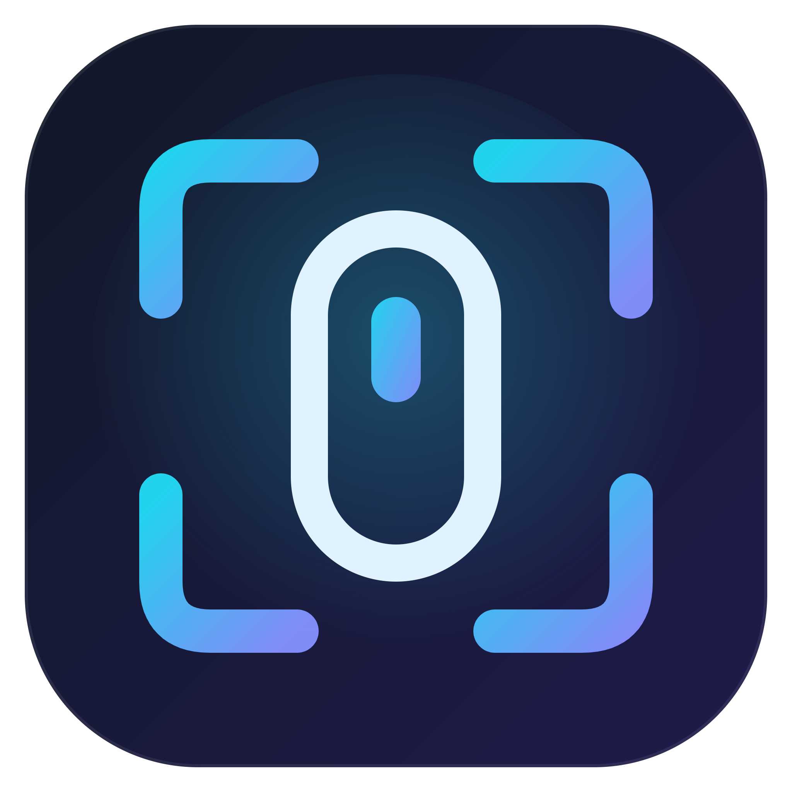
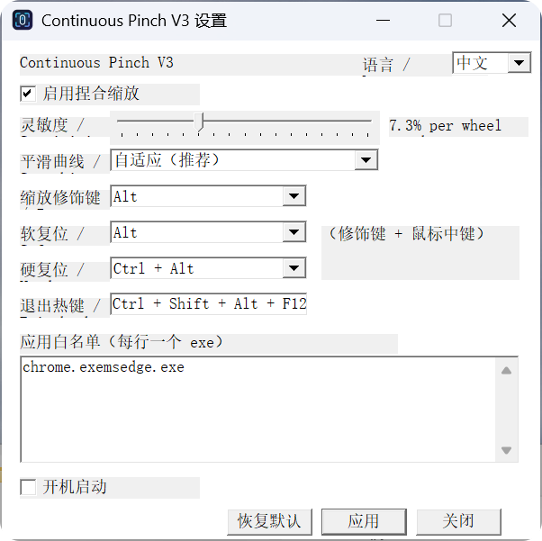
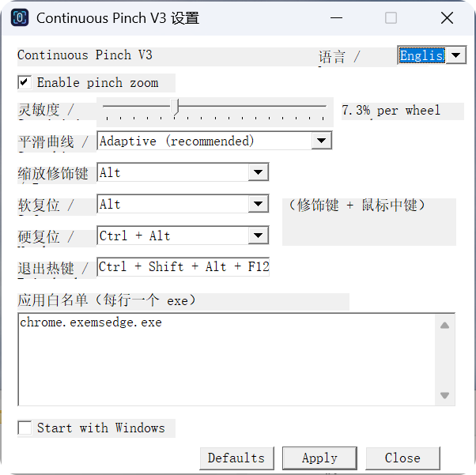

<p align="center">
  
</p>

<h1 align="center">Continuous Pinch</h1>

<p align="center">
  Windows 11 鼠标滚轮模拟 Precision Touchpad 捏合缩放
</p>

<p align="center">
  <strong>Windows 11 · Synthetic Precision Touchpad · Mouse Wheel Pinch Zoom</strong>
</p>

---

一个面向 Windows 11 的鼠标滚轮捏合缩放工具。

Continuous Pinch 将鼠标滚轮输入转换为 **Windows 11 Synthetic Precision Touchpad** 的 pinch gesture，从而获得更接近触控板双指捏合的网页缩放体验，而不是传统的 `Ctrl + 滚轮` 页面缩放。

> English: Continuous Pinch converts mouse-wheel input into Windows 11 synthetic Precision Touchpad pinch gestures for browser-style viewport zoom.

---

## 功能特性

- 使用 Windows 11 Synthetic Precision Touchpad
- `Alt + 滚轮` 执行触控板式捏合缩放
- 只允许从工具记录的 100% 基准向上放大
- 向下缩小时最低回到 100% 基准
- `Alt + 中键` 平滑回到 100% 基准
- `Ctrl + Alt + 中键` 硬复位虚拟触控板
- 支持慢速逐格滚轮
- 系统托盘
- 中文 / English 界面切换
- 默认中文
- 配置文件持久化
- 热键可配置
- 多种 smoothing 曲线
- 应用白名单
- 实时灵敏度调节
- 开机启动
- Chrome / Edge 默认支持

---

## 软件截图

建议将截图放在：

```text
assets/screenshots/
```

推荐文件名：

```text
settings-cn.png
settings-en.png
tray-menu.png
```

### 中文界面



### English UI



### 系统托盘


---

## 默认操作

| 功能 | 默认操作 |
|---|---|
| 放大 | `Alt + 滚轮向上` |
| 缩小 | `Alt + 滚轮向下` |
| 回到 100% 基准 | `Alt + 中键` |
| 硬复位虚拟触控板 | `Ctrl + Alt + 中键` |
| 退出 | `Ctrl + Alt + Shift + F12` |

---

## 100% 基准说明

Continuous Pinch 维护的是自己的逻辑缩放基准。

程序启动时默认：

```text
logicalScale = 1.0
```

工具允许：

```text
100% -> 放大 -> 缩小 -> 回到 100%
```

但不会继续缩小到工具记录的 100% 以下。

需要注意：

如果你在程序运行期间使用真实触控板、浏览器其它手势、其它软件或其它方式修改了页面视觉缩放，Continuous Pinch 无法直接读取浏览器当前 viewport scale，因此工具内部的 100% 基准可能与页面实际状态产生偏差。

这时可以使用：

```text
Alt + 中键
```

进行软复位，或者：

```text
Ctrl + Alt + 中键
```

执行硬复位。

---

## 慢速滚轮支持

如果你按住 `Alt`，然后一格一格缓慢滚动鼠标滚轮，Continuous Pinch 会保持同一个虚拟触控板手势 session。

例如：

```text
按住 Alt
→ 滚一格
→ 等 1 秒
→ 再滚一格
→ 再等 1 秒
→ 再滚一格
```

只要缩放修饰键仍然按住，就不会因为滚轮事件间隔较长而提前结束 pinch。

---

## Smoothing 模式

设置界面提供多种平滑模式：

- Direct / immediate
- Linear
- Exponential
- Adaptive

推荐默认使用：

```text
Adaptive
```

如果希望更直接、更跟手，可以尝试：

```text
Direct / immediate
```

或者提高灵敏度。

---

## 应用白名单

默认白名单：

```text
chrome.exe
msedge.exe
```

可以在设置窗口中修改。

一行一个可执行文件名，例如：

```text
chrome.exe
msedge.exe
brave.exe
```

只有白名单内的前台应用会响应 Continuous Pinch。

---

## 系统要求

- Windows 11
- Visual Studio 2022 / MSVC
- Windows SDK
- 支持 Precision Touchpad gesture 的目标应用

推荐：

- Microsoft Edge
- Google Chrome

---

## 项目结构

```text
continuous-pinch/
├─ src/
│  └─ ContinuousPinch.cpp
├─ app.ico
├─ app.rc
├─ resource.h
├─ build.bat
├─ README.md
├─ CHANGELOG.md
├─ RELEASE_NOTES.md
└─ .gitignore
```

---

## 编译

打开：

```text
x64 Native Tools Command Prompt for VS 2022
```

然后进入项目目录：

```bat
cd /d 你的项目目录
```

运行：

```bat
build.bat
```

或者手动编译：

```bat
rc /nologo app.rc

cl /nologo /std:c++17 /EHsc /O2 /utf-8 ^
src\ContinuousPinch.cpp ^
app.res ^
user32.lib ^
comctl32.lib ^
winmm.lib ^
shell32.lib ^
advapi32.lib ^
/Fe:ContinuousPinch.exe ^
/link /SUBSYSTEM:WINDOWS
```

---

## 配置文件

程序运行后会在 EXE 同目录保存配置文件。

配置内容包括：

- 当前语言
- 是否启用
- 灵敏度
- smoothing 曲线
- 热键
- 应用白名单
- 开机启动

---

## 托盘菜单

程序启动后会常驻 Windows 系统托盘。

可以通过托盘菜单：

- 启用 / 禁用
- 打开设置
- 回到 100% 基准
- 硬复位虚拟触控板
- 设置开机启动
- 退出

双击托盘图标可以直接打开设置窗口。

---

## 图标资源

项目使用：

```text
app.ico
```

并通过：

```text
app.rc
resource.h
```

将应用图标编译进 EXE。

---

## 工作原理

传统页面缩放：

```text
Mouse Wheel
→ Ctrl + Wheel
→ Browser Page Zoom
```

Continuous Pinch：

```text
Mouse Wheel
→ Continuous Pinch
→ Windows Synthetic Precision Touchpad
→ PT_TOUCHPAD
→ Pinch Gesture
→ Browser Viewport Zoom
```

Continuous Pinch 的目标是模拟真正的触控板捏合手势，而不是浏览器缩放百分比快捷键。

---

## 已知限制

- 仅支持 Windows 11。
- 工具维护的是自己的逻辑 100% 基准。
- 无法自动同步其它设备或其它程序产生的 viewport pinch scale。
- 普通机械滚轮本身属于离散输入，因此手感无法与真实高采样率触控板完全一致。
- 不同鼠标可能需要不同灵敏度设置。
- 某些应用对 synthetic touchpad gesture 的支持可能不同。

---

## 版本

当前公开版本：

```text
v1.0.0
```

内部开发过程中曾使用 V1 / V2 / V3.x 作为开发编号。

GitHub 正式发布从：

```text
v1.0.0
```

开始。

---

## English Summary

Continuous Pinch converts mouse-wheel input into Windows 11 synthetic Precision Touchpad pinch gestures.

Features include:

- Windows 11 PT_TOUCHPAD injection
- Mouse-wheel pinch zoom
- Logical 100% minimum baseline
- Slow single-notch wheel support
- Soft reset and hard reset
- System tray
- Chinese / English UI
- Configurable hotkeys
- Multiple smoothing curves
- Application whitelist
- Real-time sensitivity adjustment
- Start with Windows

Default controls:

```text
Alt + Wheel Up
    Zoom in

Alt + Wheel Down
    Zoom out, never below the tool's baseline

Alt + Middle Click
    Return to baseline

Ctrl + Alt + Middle Click
    Hard reset

Ctrl + Alt + Shift + F12
    Exit
```

---

## License

暂未选择开源许可证。
